<h1 align="center">The Curio Cabinet</h1>
<p align="center"><strong>A WebXR gallery of intricate little machines.</strong><br/>
Pick a curio from the shelf, hold it in your hands, wind it up, and step inside it.</p>

<p align="center">
  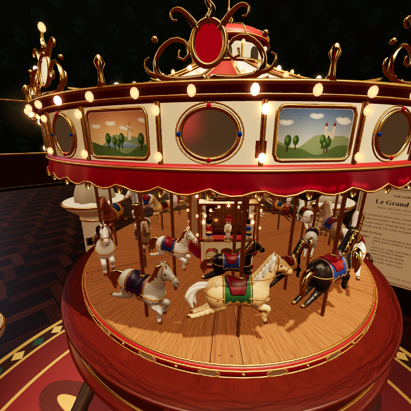
  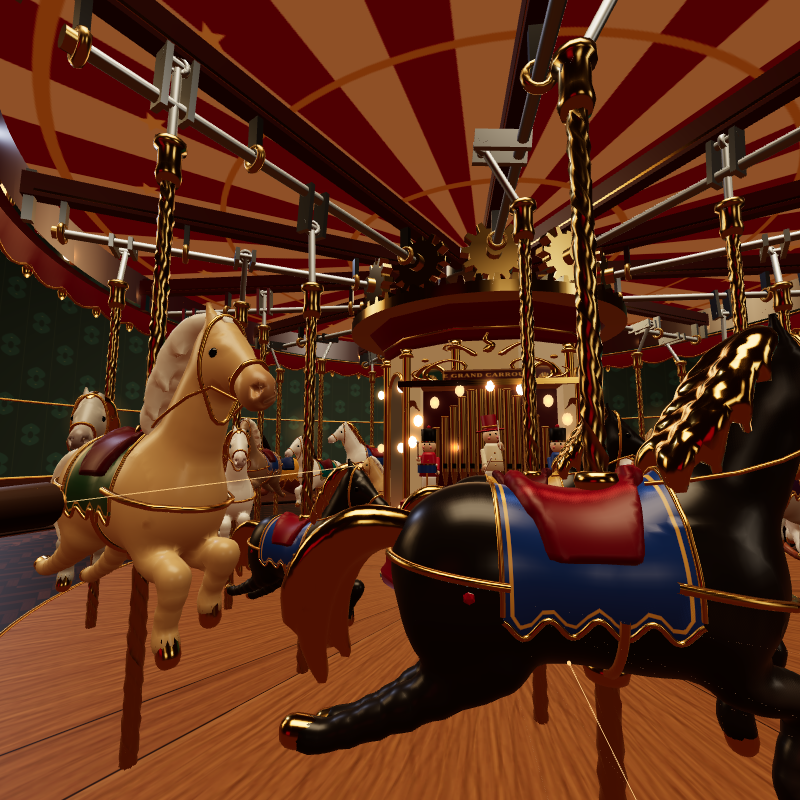
</p>

The Curio Cabinet is two things:

1. **A reusable 3D asset library** (`library/`) of highly detailed, animated, procedurally built objects for VR projects. Every asset is code: no model files, no textures to download. Each one comes in a cheap **shelf** version and a full-detail **hero** version.
2. **A WebXR viewer** (`src/`), a dim, warm gallery for Meta Quest. Low-detail previews sit on pedestals. Point at one and the full-detail version is built, assembles itself on the display table, and is yours to pick up, turn over, wind, scale with two hands, or blow up to life size and walk through.

## The first curio: *Le Grand Carrousel*

An antique clockwork music-box carousel ("Atelier Merveille, Paris, c. 1898", imagined). About half a metre across on the table, 11 m across at life size.

<p align="center">
  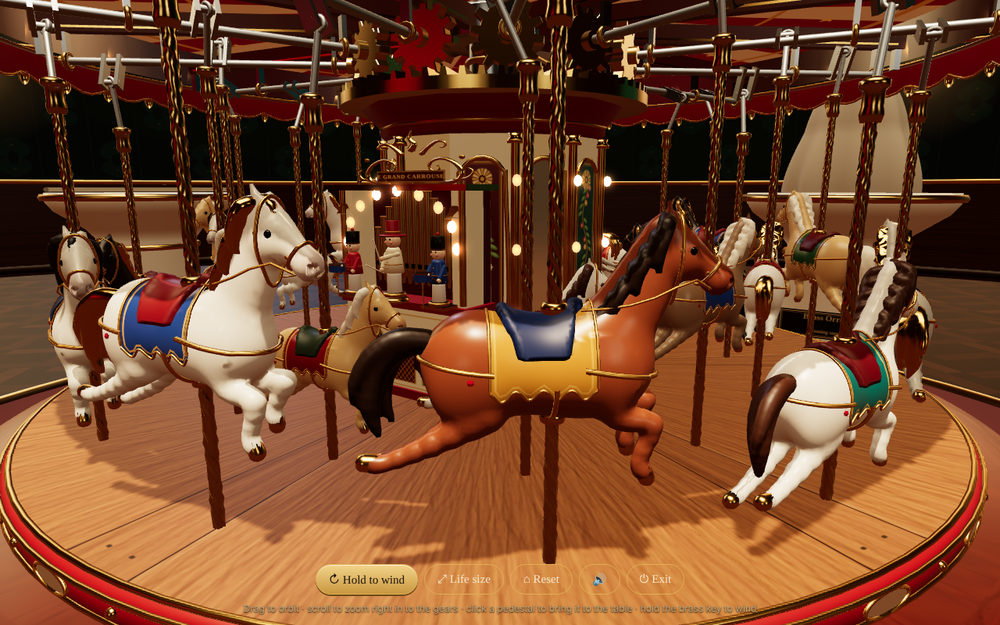
  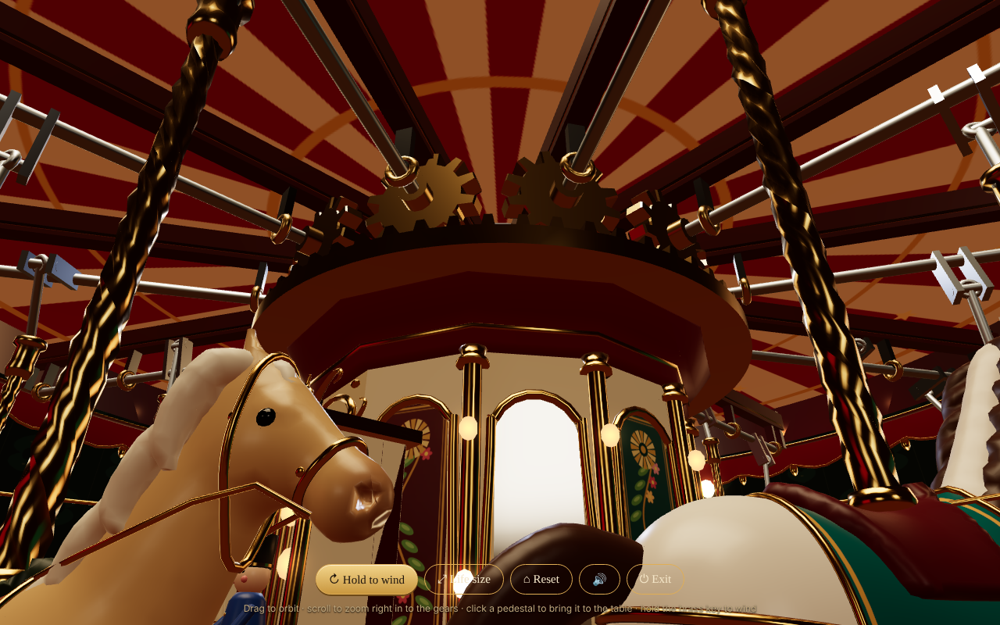
</p>
<p align="center">
  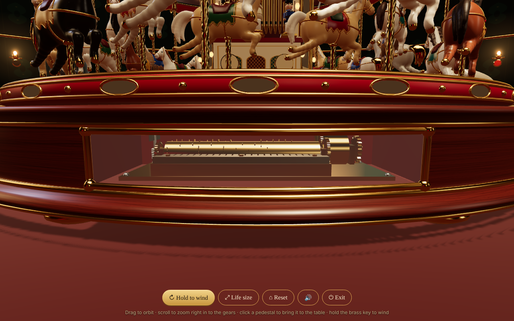
  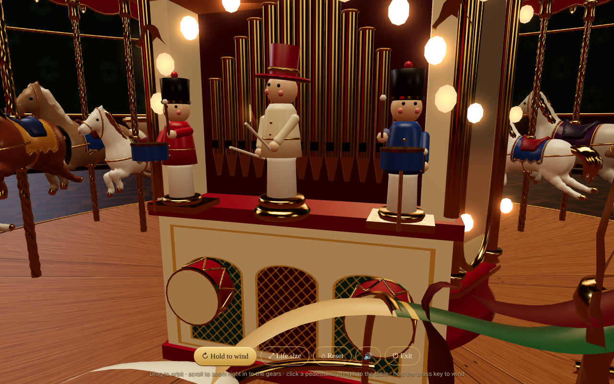
</p>

- **24 carved horses.** Each is sculpted from signed distance fields (smooth-blended capsules and ellipsoids) and meshed with Surface Nets in a Web Worker. They wear gilded straps, ruby and sapphire jewels, scalloped saddle blankets and flowing manes. Each has its own livery, and the outward "romance side" carries the extra trim.
- **A working mechanism.** Twelve crankshafts hang under the canopy. Each has a pinion that rolls round a stationary crown gear, so every shaft turns 5.17 times per revolution. Each horse rides a slider-crank with a real connecting rod, and the heights you see are computed from that geometry.
- **A real music box.** You can see a pinned brass cylinder and a steel comb through the curved glass window in the base. The pins are placed from the score of an original waltz, *Valse du Carrousel*, so each comb tooth you see quiver is the note you hear. A spring barrel turns and a governor fan spins.
- **A clockwork spring.** Turn the brass key to wind it. The ratchet clicks, and you feel it through the controller. The carousel spins up with flywheel inertia, then slows and the tune drags as the spring runs down.
- **A band organ** with brass pipes, drums, two drummer automata and a bandmaster beating 3/4 time.
- **Antique finish.** Mahogany plinth, bead mouldings, mirrored and hand-painted rounding boards, a scalloped valance with gold tassels, gilded filigree cresting, a striped tent roof, a sunburst ceiling, a cupola, a waving pennant, and about 230 incandescent bulbs running chase patterns.
- **A self-assembly show** when it's brought to the table. The base rises, the deck spins down, poles shoot up, horses drop onto them one by one, the canopy lowers, and the lights come on in a wave.

<p align="center">
  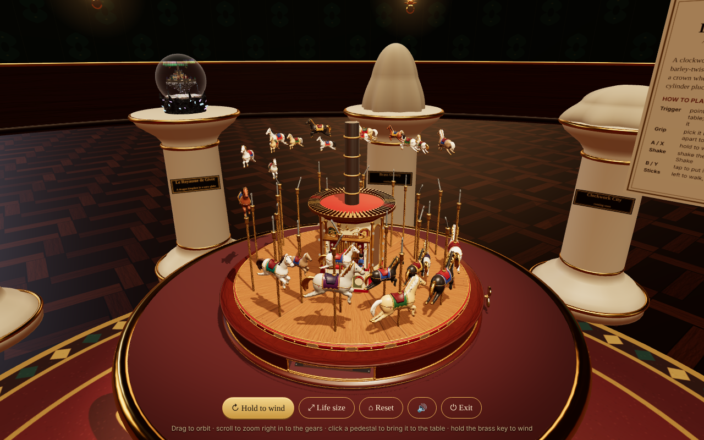
  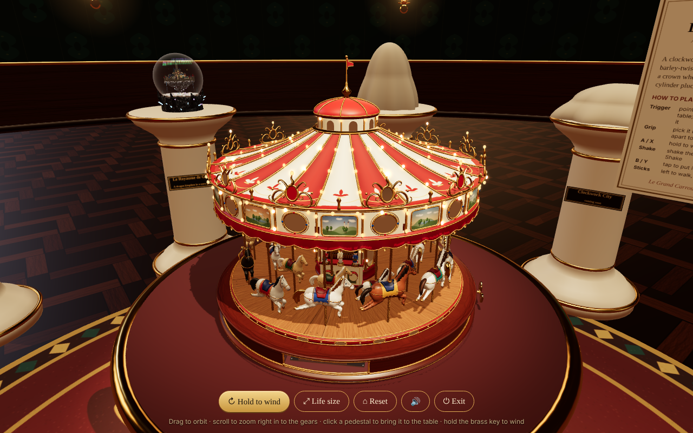
  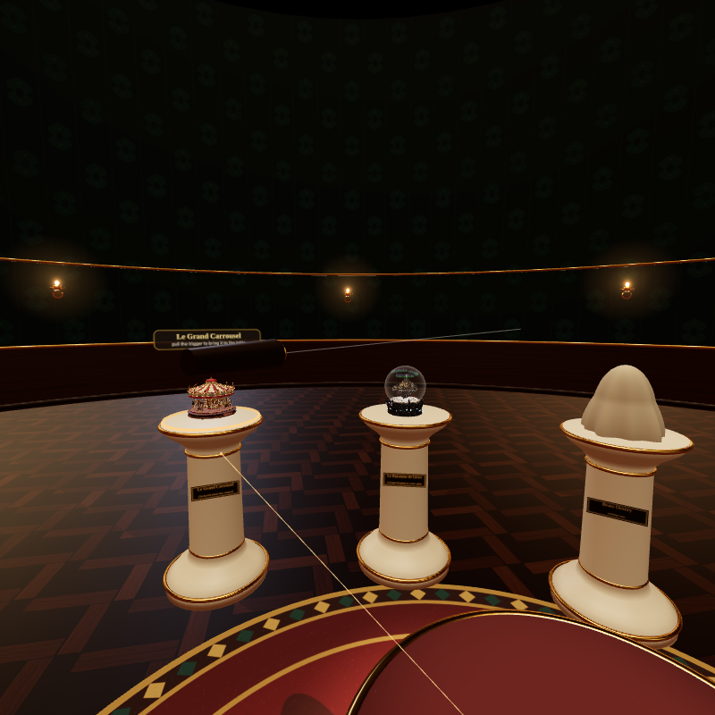
</p>

## The second curio: *Le Royaume de Givre*

A crystal snow globe on a base of near-black obsidian. Rock claws curl up around the glass, and clusters of glowing ice-blue and violet crystals sprout from the rock. A floating island kingdom drifts inside.

<p align="center">
  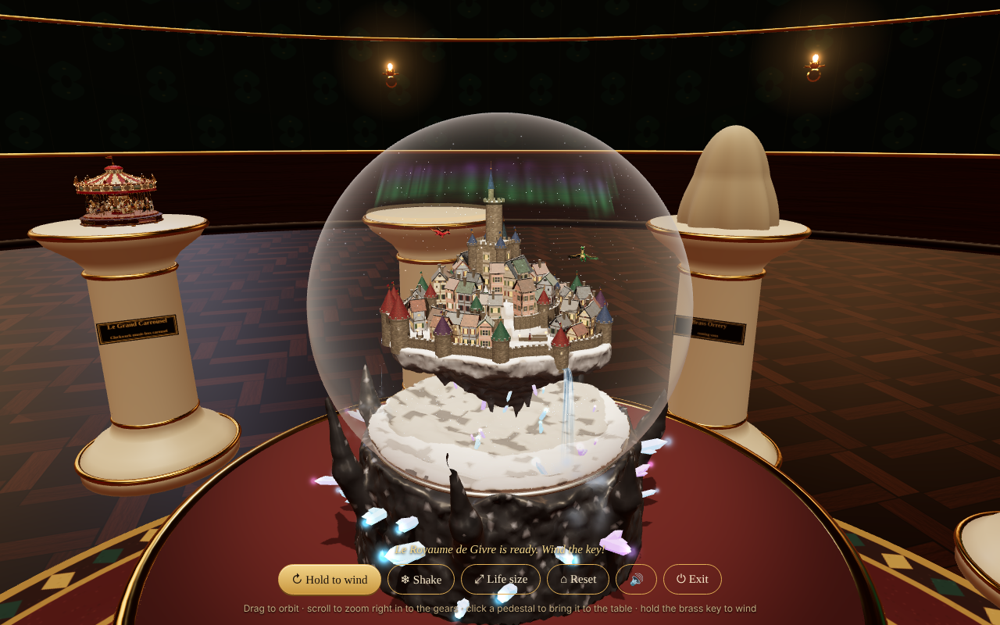
  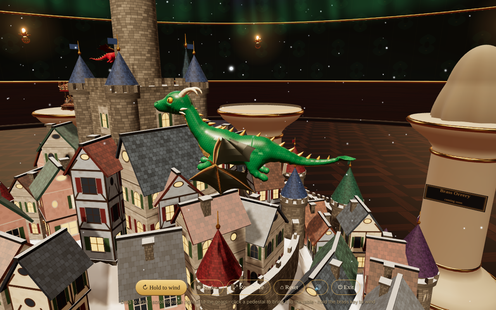
</p>
<p align="center">
  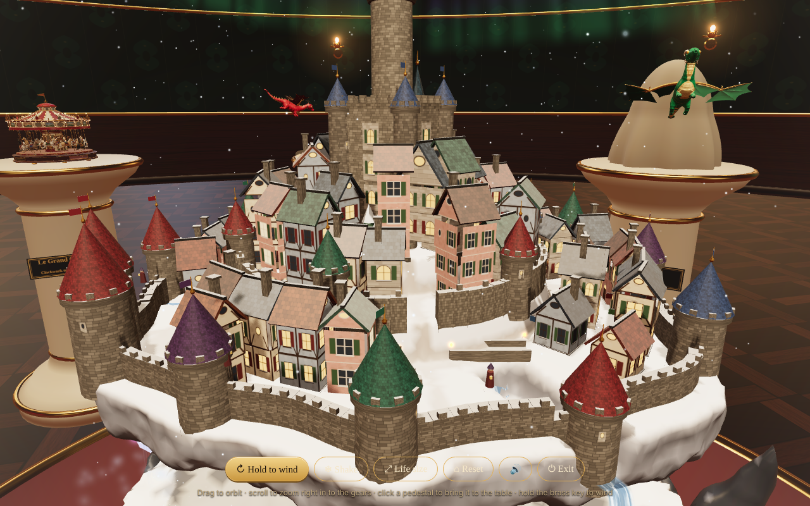
  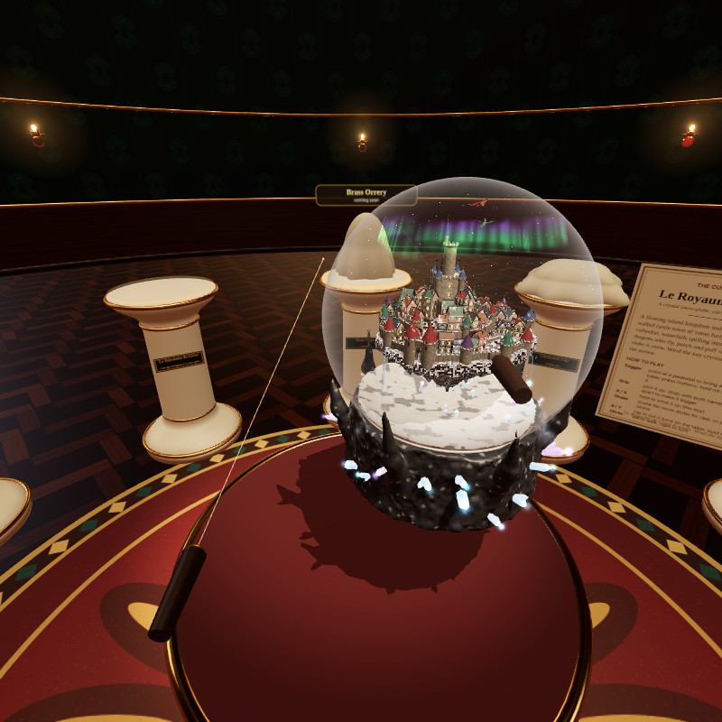
</p>

- **The island:** a chunk of rock with stalactites and glittering crystals underneath, sculpted as signed distance fields like the horses. It has three snowy terraces with cobbled lanes. A river runs through a ravine and spills off the cliff, and two smaller streams fall too. The water thins into drifting mist on the way down to the snowy floor.
- **The town:** generated procedurally on the terraces.
  - About forty houses with timber-framed, stone or plaster fronts and jettied upper floors. They're carved, not just painted:
    - deep window frames with open shutters, sills and flower boxes;
    - half-timbering that stands proud of the plaster;
    - door surrounds with steps, hoods and lamps, and wreaths and garlands;
    - balconies, dormers, bargeboards and wrought-iron shop signs;
    - strings of coloured lights, a lip of snow with icicles along every eave, and chimney pots that smoke.
  - The surfaces have relief: dressed stone with frost in the joints, tiled roofs with snow resting along the rows, wood grain, and cobbled streets with snow packed between the setts.
  - Walls with crenellations, slits and stairs up to the wall-walk, and towers with coloured cone roofs and pennants flying.
  - A gatehouse with an arch, a half-raised portcullis, open gates, a coat of arms and long banners. The river passes under the wall where it crosses the ravine.
  - A keep with turrets and a tall tower, a great hall, a cathedral with a stained-glass rose window and a bell-tower spire, a windmill with turning sails, an arched bridge, a market well, snowy pines and street lanterns.
  - Lantern-bearers walk the walls and townsfolk stroll the streets, never through a building. There's a market at the gate with snowmen about. Windows light up one by one as night falls.
- **Two dragons,** Émeraude and Rubis, sculpted with horns, cheek spikes, fangs, jewelled slit-pupil eyes, a ridge of gold spines, a ridged belly and a spade tail. Scales are carved into the surface in the shader, and the wings flap in two hinged panels. Each runs its own behaviour loop: wander between the towers banking into turns, pick a free perch (the keep's lookout, the point of a wall tower's cone, the tip of the cathedral spire), circle in above it, drop down onto it and flare to land, rest with wings folded, look around, stretch, puff smoke or a little flame, then leap straight up and fly off. They steer around the town using a height map of every roof, tower and spire, and stay inside the glass. Shaking the globe startles them into the air.
- **Shake it** in VR by grabbing and actually shaking it, or press *Shake*. Thousands of flakes kick up into a swirling vortex, drift down, and settle on the roofs and lanes, which slowly turn white.
- **Turn the key crystal** on the front of the base for an original lullaby, *Berceuse du Givre*. The night deepens, the crystals glow brighter and an aurora ripples across the inside of the dome under twinkling stars.
- **Up close** lifts just what's inside the globe out of the glass and blows it up to about 5 m across. It floats in a snowy night with its streets at waist height, the waterfalls falling away into mist. You stand on a walkway around it and can lean in over the rooftops while the dragons swoop overhead.

<p align="center">
  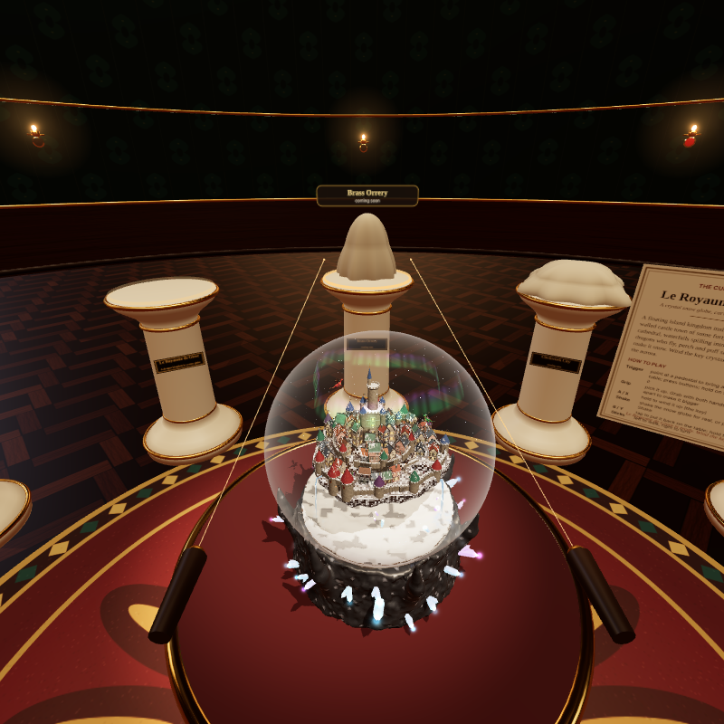
  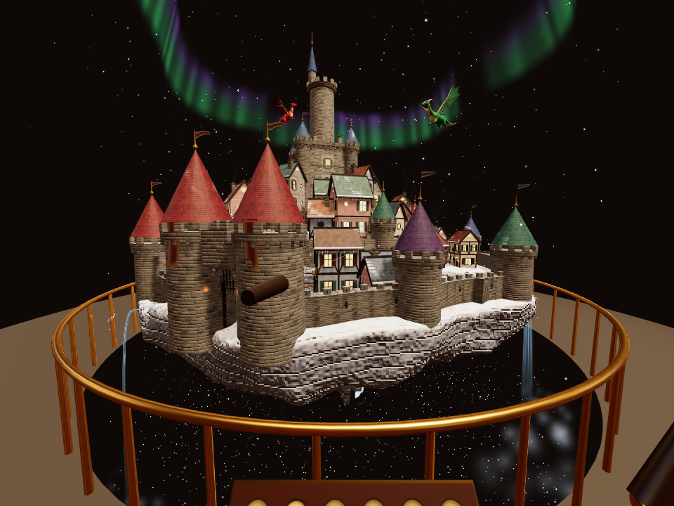
  
</p>

## Try it

**On a Meta Quest (2, 3, 3S, Pro):** open the published page in the Quest browser and press **Enter VR**. When GitHub Pages is enabled for this repository (Settings → Pages → *GitHub Actions*), the `Deploy to GitHub Pages` workflow publishes `main`.

**Locally:**

```bash
npm install
npm start          # http://localhost:8080 for desktop, https://<LAN-ip>:8443 for the Quest
```

The headset needs HTTPS for WebXR. The dev server makes a self-signed certificate with `openssl`, and you accept the warning once.

### Controls

| | VR (Touch controllers) | Desktop |
|---|---|---|
| Bring a curio to the table | point at its pedestal + **trigger** | click the pedestal |
| Wind it up | **trigger** on the key (brass key / key crystal), or hold **A/X** | hold the key, the *Hold to wind* button, or **W** |
| Shake the snow globe | grab it and shake it, or the *Shake* button | the *Shake* button or **S** |
| Pick it up | **grip** (near it or pointing at it) | – |
| Scale and turn | **both grips**, pull apart or together | scroll to zoom right into the gears |
| Put it back | tap **B/Y** or the *Reset* button | **R** |
| Exit | hold **B/Y**, or the *Exit* button | the *Exit* button |
| Life size / Up close | the *Life size* (carousel) or *Up close* (globe) button | the button or **L** |
| Move | left stick walks, right stick snap-turns | drag to orbit |

URL options: `?instant` skips the assembly show, `?asset=carousel` or `?asset=globe` picks what loads first, `?empty` starts with an empty table.

## How it stays fast on a headset

The Quest is a mobile GPU, so the detail is spent where you're looking:

- **Shelf vs hero.** The gallery only ever holds cheap shelf builds plus one hero. Picking another curio disposes the current hero's geometries, materials and textures (the test checks that GPU memory is actually freed) before the next one is built.
- **Builds never drop frames.** Heavy work is time-sliced (`Frames.step()`, about 6 ms per frame, and this works inside WebXR where `requestAnimationFrame` stops). SDF meshing runs in a worker. Textures are uploaded and shaders compiled before anything appears.
- **Few draw calls.** `GeoBag` merges every moulding, bolt and trim into one mesh per material. Horses, poles, rods, crankshafts, comb teeth and bulbs are `InstancedMesh`es. The whole hero is about 75 draw calls.
- **Per-horse level of detail.** Each horse layer has a high- and a low-detail instanced mesh, and every frame the nearest few horses you're looking at get the full sculpt.
- **Painted, not modelled.** The saddle blankets are painted onto the body in the shader from a per-vertex distance field, which gives crisp scallops and a gold pinstripe without extra geometry.
- **Cheap lighting.** One spotlight with a shadow follows the hero and is re-fitted to its bounds every frame. Bulb glows are additive billboards, with no lights and no post-processing.

## The library

```
library/
  index.js              the catalogue (lazy-loaded entries, "coming soon" placeholders)
  core/
    sdf.js              SDF primitives: smooth union, round cones, chains, contours
    surfaceNets.js      SDF -> smooth indexed mesh (pure JS, runs in a worker)
    sdfWorker.js        worker that meshes model layers off the main thread
    sdfClient.js        worker client + inline fallback -> BufferGeometry
    geometry.js         GeoBag merging, lathes, gears, crown gears, twisted poles,
                        tapered tubes, filigree cresting, bending panels onto cylinders
    materials.js        antique palette, MaterialKit (tracks + disposes), paint-mask shader
    bulbs.js            strings of bulbs with chase patterns and glow billboards
    glowPoints.js       thousands of billboarded soft points in one draw call (snow, mist, sparks)
    textures.js         procedural canvas textures (wood, wear, lettering)
    asset.js            the asset contract: Emitter, Timeline (assembly scripts), easing
  carousel/
    index.js            createCarousel(ctx, { lod }): state, spring, music, assembly
    horseModel.js       the carved horse as SDF layers (+ straps, gems, eyes)
    horses.js           24 instanced horses with LOD, poles and crank rods
    plinth.js           the base, the window and music movement, the winding key
    column.js           the mirrored centre column, crown gear, band organ, automata
    rotor.js            the deck, sweeps, crankshafts, rounding boards, roof, cupola, flag
    paintings.js        the hand-"painted" panels, roof, ceiling and deck
    score.js            Valse du Carrousel (also places the cylinder pins)
    dimensions.js       every mechanical dimension in one place
  globe/
    index.js            createGlobe(ctx, { lod }): night, wind, shaking, music, assembly
    terrain.js          the island's terraces, ravine, streams and street plan (shared by mesher and town)
    islandModel.js      island, inner floor and obsidian base as SDF layers (+ crystal anchors)
    town.js             the procedural castle town, merged into a few meshes with town-wide shaders
    townTextures.js     the painted façade atlas (with glowing windows), roof tiles, stone, rose window
    dragonModel.js      the dragon as SDF layers (body with belly mask, horns, spines)
    wings.js            two-panel hinged wings with finger bones and scalloped membranes
    dragons.js          the two dragons: rendering + fly / land / perch / take-off behaviour
    water.js            river, waterfalls and mist
    snow.js             the snow simulation (shake, swirl, settle)
    crystals.js         glowing crystal clusters
    glass.js            fresnel glass, aurora curtains, stars
    score.js            Berceuse du Givre
```

### Adding a curio

1. Make `library/<name>/index.js` exporting `info` (`name`, `maker`, `blurb`, `scale`, `bounds`) and `async create<Name>(ctx, { lod })`. It returns `{ root, update(dt, view), interactions, events, assemble?, skipAssembly?, wind?, dispose }`. See the contract in `library/core/asset.js`.
2. Build in life-size metres. The viewer applies `info.scale` for the toy view. `info.life` sets the big view: its button label, its scale (1 for true life size), the floor height and where you stand.
3. Call `await ctx.step()` between expensive pieces, and `ctx.progress(f, label)` to report.
4. Add an entry to `library/index.js`. The shelf, loader, grab, scale, audio and spotlight all work automatically.

The `dev/` pages are a small lab for sculpting. `dev/horse.html?yaw=0` and `dev/dragon.html` render the creature models alone, and `dev/asset.html?asset=globe` renders a whole asset with no gallery around it.

## Tests

```bash
npm run lint
npm test           # headless Chromium: desktop run, then an emulated Quest with two Touch controllers
```

The test boots the gallery and plays through the real interactions:
- the assembly
- winding with the keyboard and with a laser on the key (including haptic clicks)
- the music box playing
- grabbing it and lifting it to the face, and the two-handed stretch
- putting it back, life size and walking
- putting it away (checking GPU memory is freed) and bringing it back from the shelf
- entering VR off-centre and landing at the table
- the Exit button and hold-B exit
- for the snow globe: its town and perches, the dragons flying inside the glass, shaking it into a blizzard, Up close, and five simulated minutes of dragon flight that must never enter a building or leave the glass
- the whole visit again on **Meta's own WebXR emulator** ([IWER](https://github.com/meta-quest/immersive-web-emulation-runtime), the emulator behind Meta's Immersive Web SDK) as a Quest 3 with Touch Plus controllers, driven only through the controls: pointing at a pedestal and pulling the trigger, the Up close button, walking round the walkway with the stick, tapping B, squeezing the grip to pick the globe up and shaking it, and the Exit button

It also writes the screenshots in `docs/screenshots`.

### Driving an emulated Quest by hand

`tools/xr/quest.mjs` runs the gallery on IWER as a Quest 3 and takes one command at a time, so you (or a coding agent) can step inside, look around, point, click and screenshot what the headset sees:

```bash
node tools/xr/quest.mjs serve --query "?instant&asset=globe" --out shots &
curl -s localhost:9555 -d '{"cmd":"enter"}'
curl -s localhost:9555 -d '{"cmd":"aim","hand":"right","at":"button:life"}'
curl -s localhost:9555 -d '{"cmd":"press","hand":"right","button":"trigger"}'
curl -s localhost:9555 -d '{"cmd":"stick","hand":"left","y":-1,"ms":1200}'
curl -s localhost:9555 -d '{"cmd":"head","look":[0,1.75,0]}'
curl -s localhost:9555 -d '{"cmd":"shot","file":"town.png"}'
```

Targets are world positions in metres or names of things in the scene (`pedestal:globe`, `button:shake`, `proxy:hero`). The full command list is at the top of the file. `node tools/xr/quest.mjs run steps.json` plays a saved list of commands.

`node tools/xr/tour.mjs --out shots` runs a fixed inspection tour of the snow globe's Up close view. It visits about twenty viewpoints:
- round the walkway and leaning over the rail;
- in front of particular houses, a door, the eaves, a balcony, a shop sign and string lights;
- the gate, the keep and the cathedral;
- a snowman, townsfolk, both dragons (held still), a waterfall and under the island.

It also prints the triangle and draw-call counts and the town's build time, so a change can be checked before and after.

## What's next

The shelf still has dust cloths over a **brass orrery**, a **clockwork city** that builds itself (traffic, day and night, windows lighting up) and a **lighthouse** with waves and a turning lamp. Other ideas: a steam train on a figure-eight, a Ferris wheel, a marble run, a snow globe you shake, an aquarium, and a cuckoo clock.
