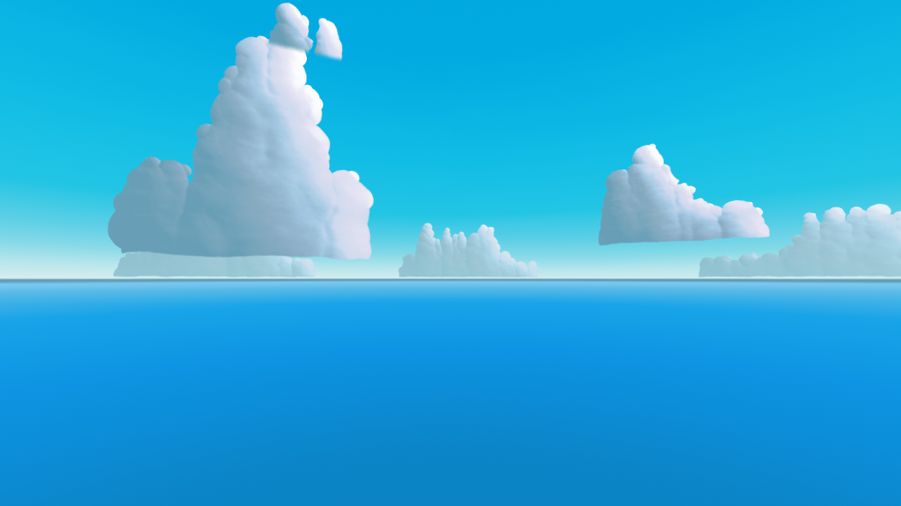

# Sea Train

A WebXR ride across a painted sea. You sit in an old train car and glide over
shallow water under a huge Ghibli-blue sky, with towering cumulus clouds and a
small island drifting past. It should look like an animated film, not like real life.

The previous project, Color Zone XR, is kept in [`archive/`](archive/).



## Run it

```sh
npm install
npm start          # http://localhost:8080 on desktop (drag to look around)
                   # https://<LAN-ip>:8443 on a Quest (accept the certificate warning once)
npm run shot       # screenshots from six directions -> docs/screenshots/
npm run shot -- --frames=48 --travel=900   # frames of the ride, for checking parallax
npm test           # exit and pause behaviour in an emulated Quest
```

## Leaving the ride

- **In VR:** hold **B** or **Y** for 1.5 seconds. A ring fills up in front of you; letting go cancels.
- **On the page:** the **Quit** button.

Quitting really stops everything. It ends the VR session, stops rendering, runs
every module's shutdown hook (sound will be closed there), frees the GPU and
destroys the WebGL context. Then it moves the tab to a static `ended.html`
page, so none of the app's code is left running or holding memory. A web page
can't close its own tab, so this is the closest thing to closing it.

Leaving VR any other way (the Quest menu, taking the headset off) **pauses**:
nothing runs until you choose Back to VR, Watch here or Quit. A hidden tab pauses too.

`npm test` checks all of this in an emulated Quest (see `tools/test/exit.mjs`).
Every new module that starts something outside the render loop (audio, timers,
workers) must register pause and shutdown hooks with `src/lifecycle.js`.

## Palettes

Add `?palette=summer` or `?palette=castle` to the URL to try another palette.
The default is `seaTrain`.

There is no build step: plain ES modules plus a copy of Three.js (r185) in `vendor/three`.
Pushing to `main` deploys the site to GitHub Pages.

## Palette

All colors live in [`src/palette.js`](src/palette.js). They were sampled from
reference stills, and each value is tagged with the still it came from.
The stills themselves are copyrighted, so they stay out of the repo: put local
copies in `reference/`, which git ignores.

## Modules

Each module is a working build you can open in the headset before the next one is added.

| # | Module | Status |
|---|--------|--------|
| 0 | Groundwork: Three.js + WebXR, dev server, Pages deploy | done |
| 1 | Palette sampled from reference stills, with switchable presets | done |
| 2 | Sky: painted gradient dome; cumulus painted on the GPU as lit volumes, arranged in four parallax layers (far, mid, near, overhead) | in progress |
| 3 | Water: sun glitter painted as dabs, ripples, cloud reflections | placeholder only |
| 4 | Motion: the world slides past at a gentle train speed (`?speed=<m/s>`, default 14) | first pass |
| 5 | Distant scenery: island with houses, poles, far shoreline in haze | |
| 6 | Train car: red seats, wood window frames, hand rings, sway | |
| 7 | Painterly finish: soft edges, paper grain, color grading | |
| 8 | Sound: train rhythm, wind, ambience | |
